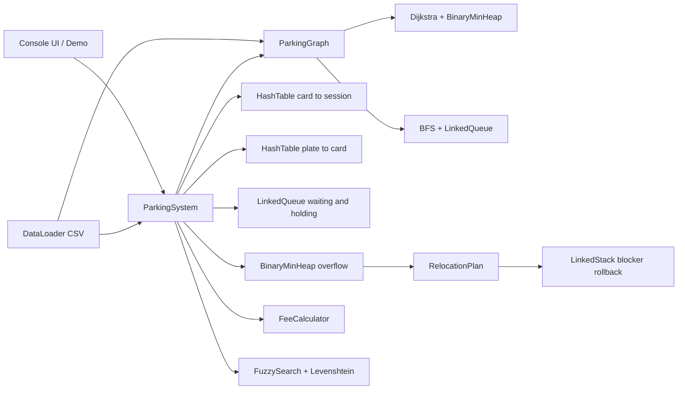
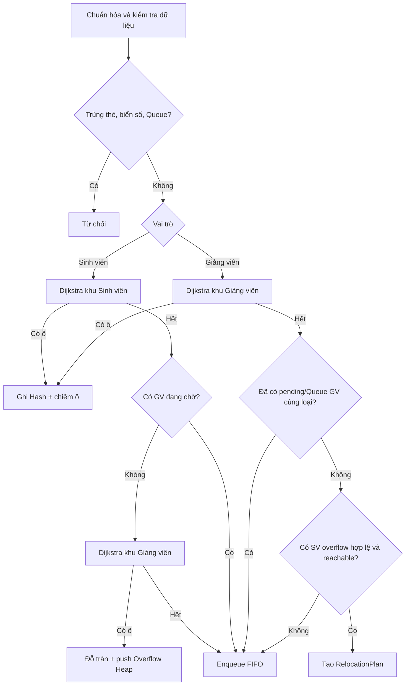

# 1. Phân tích và thiết kế hệ thống

## 1.1. Mục tiêu

Hệ thống phải giải quyết đồng thời ba nhóm bài toán:

1. **Quản lý dữ liệu động:** xe vào/ra liên tục, cần tra cứu nhanh theo mã thẻ và
   biển số, đồng thời giữ trạng thái ô đỗ nhất quán.
2. **Tối ưu đường đi:** bản đồ có các lối đi dài ngắn khác nhau nên cần tìm ô
   trống gần nhất theo tổng khoảng cách, không chỉ theo số cạnh.
3. **Điều phối khi quá tải và dữ liệu không hoàn hảo:** xe phải chờ khi bãi đầy,
   camera có thể nhận sai biển số, sinh viên có thể đỗ tràn sang khu Giảng viên.

Mục tiêu kỹ thuật là thể hiện rõ CTDL & giải thuật thay vì chỉ xây một CRUD app.

## 1.2. Phạm vi chức năng

- Đọc bản đồ và log camera từ file.
- Check-in, chống trùng thẻ/biển số, gán ô đỗ và in lộ trình.
- Check-out, tính phí tự động, giải phóng ô và nhận xe chờ.
- Quản lý Queue FIFO khi hết chỗ.
- Fuzzy Search trả tối đa ba xe đang hoạt động gần giống truy vấn nhất.
- Phân khu Sinh viên/Giảng viên và cho phép đỗ tràn có điều kiện.
- Priority Queue chọn sinh viên đỗ tràn sớm nhất.
- Stack lập thứ tự đưa xe chắn ra và hoàn nguyên.
- Sắp lịch sử bằng Merge Sort và kiểm tra invariant sau mutation.

## 1.3. Kiến trúc



`ParkingSystem` là lớp duy nhất điều phối thay đổi trạng thái. Thiết kế này ngăn
việc UI tự sửa Hash Table nhưng quên sửa ô đỗ, hoặc ngược lại.

## 1.4. Mô hình dữ liệu chính

### `ParkingNode`

- `id`, `label`: định danh và tên hiển thị.
- `type`: cổng, giao lộ hoặc ô đỗ.
- `zone`: Sinh viên/Giảng viên.
- `acceptedVehicle`: xe máy/ô tô.
- `laneId`, `depthFromExit`: vị trí trong dãy hẹp.
- `occupiedCardId`: liên kết ngược từ ô tới session.

### `ParkingSession`

- Mã thẻ và biển số đã chuẩn hóa.
- Vai trò, loại xe, cổng vào, thời gian vào.
- Ô đang đỗ hoặc trạng thái `Holding`.
- Cờ `overflow` và sequence để tie-break.

### `VehicleRequest`

Lệnh check-in/Queue gồm thông tin xe, cổng, thời điểm yêu cầu và số thứ tự đến.

### `RelocationPlan`

- Xe sinh viên mục tiêu do Min-Heap chọn: sớm nhất trong các xe mà cổng của
  Giảng viên có đường đi tới.
- Ô cần thu hồi.
- Thứ tự đưa các xe chắn ra.
- Thứ tự hoàn nguyên tạo bởi thao tác pop Stack.
- Yêu cầu check-in của Giảng viên đang chờ xác nhận; yêu cầu này giữ thứ tự đến
  và chưa phải là một session đang tính phí.

## 1.5. Lý do chọn CTDL

### Hash Table — tra cứu phiên gửi xe

Hai bảng băm separate chaining được dùng:

- `cardId -> ParkingSession` để check-out trung bình `O(1)`.
- `normalizedPlate -> cardId` để chống một biển số check-in hai lần.

Separate chaining dùng DSLK đơn phù hợp bài giảng, xóa không cần tombstone và
rehash khi load factor vượt `0.75`.

### Linked Queue — xe chờ

Queue biểu diễn đúng FIFO. Có bốn queue độc lập:

- Sinh viên/xe máy; Sinh viên/ô tô.
- Giảng viên/xe máy; Giảng viên/ô tô.

Việc tách loại xe tránh ô tô đầu hàng chặn một ô xe máy đang trống. `front` và
`rear` giúp enqueue/dequeue đều `O(1)`.

### Binary Min-Heap — Dijkstra và xe đỗ tràn

Một template heap tự cài được tái sử dụng:

- Dijkstra ưu tiên `(distance, nodeId)`.
- Overflow ưu tiên `(entryTime, sequence, cardId)`.

Không cần decrease-key: khi có khoảng cách tốt hơn, push trạng thái mới; khi pop,
bỏ bản ghi không còn khớp. Heap overflow cũng dùng lazy deletion sau checkout.
Khi tạo relocation plan, `peekValidOverflow(type, gateId)` duyệt theo thứ tự Heap:

1. Entry stale do checkout/di dời bị loại vĩnh viễn.
2. Entry hợp lệ nhưng không reachable từ `gateId` được tạm pop sang buffer.
3. Entry hợp lệ đầu tiên có đường đi được chọn nhưng không bị pop.
4. Mọi entry tạm giữ được push lại trước khi hàm trả về.

Nhờ vậy, bản đồ nhiều cổng hoặc nhiều thành phần rời nhau chọn đúng xe overflow
sớm nhất **trong tập reachable**, đồng thời không làm mất ứng viên ở thành phần
khác hay khi plan bị hủy.

### Stack — di dời trong dãy hẹp

Giả sử xe mục tiêu ở độ sâu 3 và hai xe chắn ở độ sâu 1, 2:

1. Đưa xe độ sâu 1 ra, push Stack.
2. Đưa xe độ sâu 2 ra, push Stack.
3. Đưa xe mục tiêu ra.
4. Pop xe độ sâu 2 rồi xe độ sâu 1 để khôi phục đúng thứ tự.

Stack vì vậy có vai trò nghiệp vụ thực, không chỉ được thêm để “đủ yêu cầu”.

### Graph adjacency list

Bản đồ bãi xe thưa nên adjacency list dùng `O(V+E)` bộ nhớ, tốt hơn ma trận
`O(V²)`. Node ô đỗ giữ trạng thái động, cạnh giữ khoảng cách mét.

## 1.6. Thuật toán

### Dijkstra tới ô trống gần nhất

1. Khởi tạo `distance[start] = 0`, các node còn lại là vô cùng.
2. Push start vào Min-Heap.
3. Pop node có distance nhỏ nhất.
4. Relax mọi cạnh hợp lệ có trọng số dương.
5. Sau khi xử lý, quét các ô trống đúng khu/loại xe và chọn distance nhỏ nhất.
6. Nếu hòa, chọn mã ô từ điển nhỏ hơn.
7. Dùng mảng `parent` dựng lại đường đi.

Đồ thị mẫu chứng minh BFS chọn cạnh trực tiếp 20 m vì chỉ có một cạnh, trong khi
Dijkstra chọn đường ba cạnh tổng 10 m.

### Chọn xe overflow có thể tiếp cận

Heap cho thứ tự toàn cục theo `(entryTime, sequence, cardId)`, nhưng thứ tự đó
không tự bảo đảm một cổng bất kỳ đi tới được ô của entry đầu tiên. Hệ thống lần
lượt kiểm tra đường đi bằng Dijkstra, tạm bỏ qua entry ở component khác và chọn
entry reachable đầu tiên. Sau đó các entry bị bỏ qua được chèn lại nên thứ tự ưu
tiên toàn cục không bị phá hủy cho yêu cầu đến từ cổng khác.

### Levenshtein Distance

Trước khi so khớp, biển số được viết hoa và bỏ khoảng trắng, `-`, `.`. Công thức:

```text
dp[i][j] = min(
    dp[i-1][j] + 1,      // xóa
    dp[i][j-1] + 1,      // chèn
    dp[i-1][j-1] + cost  // giữ hoặc thay thế
)
```

Hiện thực chỉ giữ hai hàng nên bộ nhớ `O(min(m,n))`. Mọi xe đang hoạt động được
chấm điểm rồi sắp bằng Merge Sort theo `(distance, plate, cardId)` và lấy top-3.

### Merge Sort

Dùng để sắp kết quả fuzzy và lịch sử. Thuật toán ổn định, luôn `O(n log n)` và
bám trực tiếp phần Merge Sort trong bài giảng.

## 1.7. Luồng nghiệp vụ

### Check-in



`pendingRelocation` được xem là một yêu cầu Giảng viên đang chờ và đến trước
những xe được enqueue sau đó. Do đó nó cũng chặn Sinh viên lấy ô khu Giảng viên
cùng loại trong lúc plan chưa được xử lý.

### Check-out

1. Tra mã thẻ trong Hash Table.
2. Kiểm tra thời gian ra không trước thời gian vào.
3. Tính số giờ bắt đầu và phí theo loại xe.
4. Giải phóng ô nếu session đang `Parked`.
5. Xóa đồng bộ cả hai Hash Table.
6. Ghi lịch sử.
7. Nếu ô Sinh viên trống: ưu tiên xe `Holding`, sau đó Queue Sinh viên.
8. Nếu ô Giảng viên trống: ưu tiên Giảng viên trong pending relocation, sau đó
   Queue Giảng viên; chỉ khi không còn nhu cầu Giảng viên cùng loại mới nhận
   Sinh viên overflow.

### Di dời hai pha

- Pha 1 `createRelocationPlan`: chỉ lập cảnh báo, không tự ý dịch chuyển xe.
- Pha 2 `confirmRelocation`: sau xác nhận, đưa sinh viên vào `Holding`, cấp ô cũ
  cho Giảng viên và ghi hai sự kiện lịch sử.
- `entryTime` của Giảng viên được đặt bằng thời điểm xác nhận/cấp ô, nên khoảng
  thời gian xem và chờ xác nhận plan không bị tính phí.
- Nếu một ô Giảng viên cùng loại trống trước khi xác nhận, yêu cầu pending được
  cấp trực tiếp trước Queue đến sau và plan bị hủy. Do ứng viên được chọn không
  bị pop, xe overflow mục tiêu vẫn trong Heap để có thể tạo plan kế tiếp.
- Nếu giao dịch cấp ô/Hash thất bại, trạng thái xe sinh viên và ô đỗ được rollback.

## 1.8. Invariant

Sau mỗi chuỗi mutation, `validateInvariants()` kiểm tra:

1. Mỗi mã thẻ và biển số có tối đa một session; hai Hash Table có cùng số phần
   tử và trỏ qua lại đúng.
2. Mỗi ô occupied có đúng một session `Parked`; mỗi session `Parked` có đúng một
   ô trỏ ngược cùng mã thẻ.
3. Mọi ô đang dùng phải `enabled` và chấp nhận đúng loại xe của session.
4. Session `Holding` không có slot, không còn cờ overflow và xuất hiện đúng một
   lần trong Queue khu tạm đúng loại xe.
5. Mọi node trong Queue khu tạm phải trỏ tới một session `Holding` hợp lệ; không
   có mã thẻ khu tạm trùng lặp.
6. Sinh viên ở khu Giảng viên bắt buộc có `overflow=true`; Sinh viên ở khu Sinh
   viên không có cờ này.
7. Giảng viên chỉ nằm khu Giảng viên và không bao giờ mang cờ overflow.
8. Mỗi Queue chờ chứa đúng vai trò/loại xe; không trùng thẻ/biển số và không có
   xe vừa chờ vừa có session hoạt động.
9. Yêu cầu trong pending plan phải là Giảng viên có loại xe cụ thể, chưa có
   session và không đồng thời nằm trong Queue.
10. Mục tiêu của pending plan phải còn là Sinh viên `Parked`, đang overflow ở ô
    Giảng viên enabled, cùng loại xe với yêu cầu và được ô đó trỏ ngược đúng.
11. `activeSessions = occupiedSlots + holdingSessions`.

## 1.9. Độ phức tạp

| Thao tác | Thời gian | Bộ nhớ phụ |
|---|---:|---:|
| Hash find/insert/erase | TB `O(1)`, xấu `O(n)` | `O(n+b)` |
| Queue enqueue/dequeue | `O(1)` | `O(n)` tổng |
| Stack push/pop | `O(1)` | `O(b)` xe chắn |
| Heap push/pop | `O(log n)` | `O(n)` |
| BFS | `O(V+E)` | `O(V)` |
| Dijkstra + Min-Heap lazy | `O((V+E) log E)` | `O(V+E)` |
| Levenshtein một cặp | `O(mn)` | `O(min(m,n))` |
| Fuzzy trên `N` xe | `O(Nmn + N log N)` | `O(N + min(m,n))` |
| Merge Sort | `O(n log n)` | `O(n)` |
| Chọn overflow reachable sớm nhất | Xấu `O(o(V+E) log E + o log o)` | `O(V+E+o)` |
| Lập kế hoạch dãy có `b` xe chắn | `O(S + b log b)` | `O(b)` |

`S` là số ô để xác định các xe cùng lane; `o` là số entry hiện có trong Overflow
Heap, kể cả entry stale chưa được dọn. Nếu entry đầu Heap reachable, chọn
overflow chỉ chạy một Dijkstra. Cận xấu xuất hiện khi phải kiểm tra tới `o` entry
ở các component khác, đồng thời pop/push lại chúng.
Dijkstra không có decrease-key nên một đỉnh có thể được push lại sau mỗi lần
relax thành công; Heap vì vậy có thể chứa `O(E)` entry và mỗi push/pop tốn
`O(log E)`, dẫn đến cận `O((V+E) log E)`.

## 1.10. Giả định và giới hạn

- Công thức phí hiện là cấu hình mẫu, cần thay nếu đề chính thức quy định khác.
- Graph hỗ trợ nhiều cổng và thành phần rời nhau; relocation chỉ chọn target có
  đường đi từ đúng cổng yêu cầu. Hệ thống vẫn mô phỏng một tiến trình, chưa xử lý
  nhiều thao tác check-in đồng thời.
- Ở trường hợp xấu có nhiều overflow nằm ở component không reachable,
  `peekValidOverflow` chạy lại Dijkstra cho từng ứng viên. Có thể tối ưu tiếp
  bằng một lần Dijkstra/cache reachability theo cổng nếu dữ liệu rất lớn.
- Trạng thái chạy chưa được lưu qua lần khởi động; file bắt buộc của đề chỉ là
  bản đồ và log camera. Có thể bổ sung snapshot nếu rubric yêu cầu persistence.
- Fuzzy Search dùng Levenshtein chuẩn; chưa áp dụng trọng số riêng cho cặp OCR
  như `0/O`, `5/S` để giữ thuật toán dễ giải thích và kiểm chứng.
